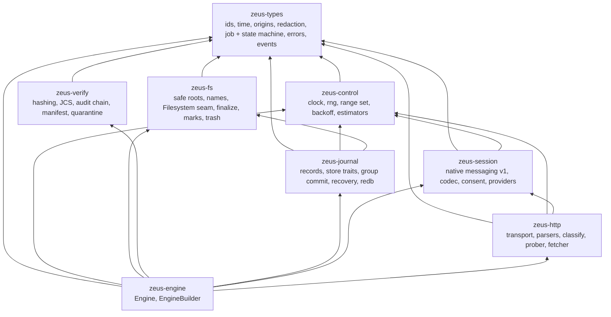
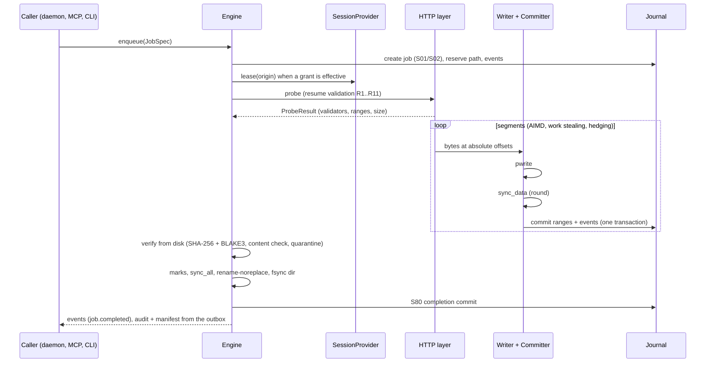

# Architecture

`zeus-core` is the embeddable engine of [Zeus](https://github.com/ArefinAlter/zeus). It is a set of libraries; the daemon, the CLI, the MCP server and the native-messaging host are in the `zeus` repository and depend on these crates by path.

## Crate dependency graph

`zeus-types` has no I/O and no async code; it is the vocabulary everything else shares. Cross-crate seams are traits so the engine is deterministic under fakes: `Clock`, `RandomSource`, `Filesystem`/`DataFile`, `JournalStore`, `HttpTransport`, `SessionProvider`, `ProxyFetch`, `ConsentStore`, `AuditSink`, `ApprovalPort`, `ContentDetector`, `FaultInjector`.

## Data flow of one download

## The commit protocol in one paragraph

A range reaches the journal only after the bytes it names were flushed: **write, `sync_data`, commit** (03 section 5). The writer task of a job issues positional writes and queues units; the daemon-wide committer snapshots the queue, syncs every touched file, and commits one journal transaction (`Durability::Immediate`) that inserts the ranges, updates progress and, when a job's set becomes complete, performs transition S20 and appends all events. Epochs fence stale workers (I5); only the committed range set is evidence of progress (I2). Finalization applies OS marks to the data file, `sync_all`s it, commits a `finalize.intent`, renames without replacing, syncs the directory and commits completion; `zeus_fs::finalize::decide_recovery` is the five-case crash decision procedure. Every crash point is a `zeus_journal::CrashPoint` an injector can trigger.

## Extension points

| To add | Implement |
|---|---|
| A different journal backend (SQLite, an in-memory simulator) | `zeus_journal::JournalStore` with `ReadTxn`/`WriteTxn` |
| A crash-simulating file system | `zeus_fs::Filesystem` and `DataFile` |
| A different transport (HTTP/3, a scripted fake) | `zeus_http::HttpTransport` |
| A source of sessions other than the extension | `zeus_session::SessionProvider` (never read browser cookie stores: ADR 0004 of the app repository) |
| An in-browser fetch fallback other than native messaging | `zeus_session::ProxyFetch` |
| A learned content detector | `zeus_verify::content::ContentDetector` |
| Where audit records go | `zeus_verify::AuditSink` |

## Status

| Crate | Implemented now | Remaining |
|---|---|---|
| `zeus-types` | Domain types, state machine, current approval bindings, event catalogue and schema/conformance tests | Contract revisions continue; no API freeze claimed |
| `zeus-control` | Clocks, randomness, ranges, backoff, EWMA, AIMD, segment planning, token bucket/GCRA and fairness | Rate estimator, Kalman/ETA uncertainty, mirror bandits, P-squared/hedging, reliability math and CUSUM |
| `zeus-fs` | Real positional files, filename handling, root containment, no-replace finalization, marks and trash | Handle-pinned root protection against directory swaps; full platform acceptance |
| `zeus-verify` | File hashes, content/quarantine decisions, JCS, durable chained audit, manifests and redacted exports | Full audit retention/repair workflows and platform hardening |
| `zeus-journal` | redb records, atomic transitions/commits, durable grant/latch state, recovery and resume validation | Migration/corruption rescue, performance indexes and broader crash matrix |
| `zeus-session` | Protocol/framing, negotiation, flow control, consent, correlation, exact-origin cookie headers | Browser adapters live in the daemon; authenticated page-rendering contract remains separate |
| `zeus-http` | Actual HTTP(S), range probe/fetch, explicit redirects, validation and bounded body handling | Wider server/interoperability matrix and authenticated URL-refresh recovery |
| `zeus-engine` | Enqueue/probe/control/wait/verify/events, durable idempotent controls, segmented execution, durable bounded retry timers, recovery, grant enforcement, atomic kill switch and browser proxy | URL refresh, adaptive scheduling/fairness integration, authenticated standalone probe semantics |
| `zeus-artifact` | Shared storage, record-only/copy ingestion, materialization, metadata, exports, GC/scrub/repair | Full cross-product lifecycle and platform acceptance |

The engine currently uses static bounded concurrency. Its loopback tests exercise strict range validation, changed validators, corrupted or replaced partial files, restart/resume and verification. Automatic retries use persisted deadlines, class budgets and full-jitter backoff with a Retry-After floor; tests cover a transient failure followed by success, restart during backoff, permanent failure, budget exhaustion, and pause/cancel/kill interruption. Session tests exercise trusted durable approval, revocation, the kill switch and browser proxy streams. These tests do not replace real Chrome/Edge/Firefox acceptance or a complete power-loss fault matrix.

URL-expiry and authentication-refresh recovery are still separate work. AIMD, rate-limiter and fairness helpers are not yet connected to the engine scheduler. Browser-proxy redirects fail closed until the URL-refresh and redirect-consent flow is validated.

The daemon can inject a per-job transport and a commit guard for workflow policy. The transport checks destinations and pacing; the commit guard runs under the journal writer so concurrent jobs cannot exceed a shared byte budget.

## Build notes

### HTTP stack

`reqwest` 0.13 with the `rustls` feature (aws-lc-rs provider, platform certificate verifier), `http2` and `stream`; default features are off so no decompression, cookie store or redirect following exists unless the code asks for it. Verified 2026-10-05: it builds, links and initialises on `x86_64-pc-windows-gnu` (rustc 1.99, MinGW gcc from MSYS2). If `aws-lc-sys` ever fails to build on a platform (it needs a C compiler and, on some targets, CMake or NASM), switch the workspace dependency to `features = ["rustls-no-provider", ...]` and install the `ring` provider at start-up; `deny.toml` bans OpenSSL and `native-tls` either way.

### redb and the MSRV

`redb` 4.x needs rustc 1.90 (4.3.0 declares `rust-version = 1.90`; 4.0 and 4.1 need 1.89), so the workspace MSRV is **1.90** and `rust-toolchain.toml` tracks `stable`. The journal is behind `JournalStore`, so the backend can change without touching the engine.

### Windows without MSVC

See [CONTRIBUTING.md](../CONTRIBUTING.md#windows-without-msvc): the GNU toolchain links with its bundled MinGW; set `RUSTUP_TOOLCHAIN` per shell.

### Small machines

Use a shared target directory outside the repository and `CARGO_BUILD_JOBS=3`; the full workspace including reqwest builds in about five minutes on 8 CPUs and 8 GB.
